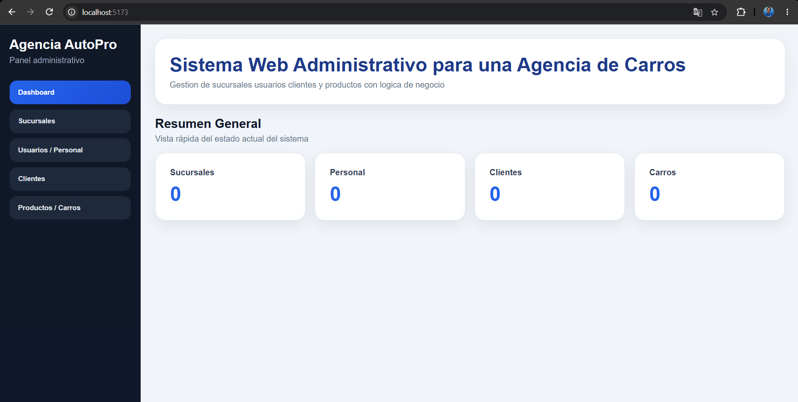
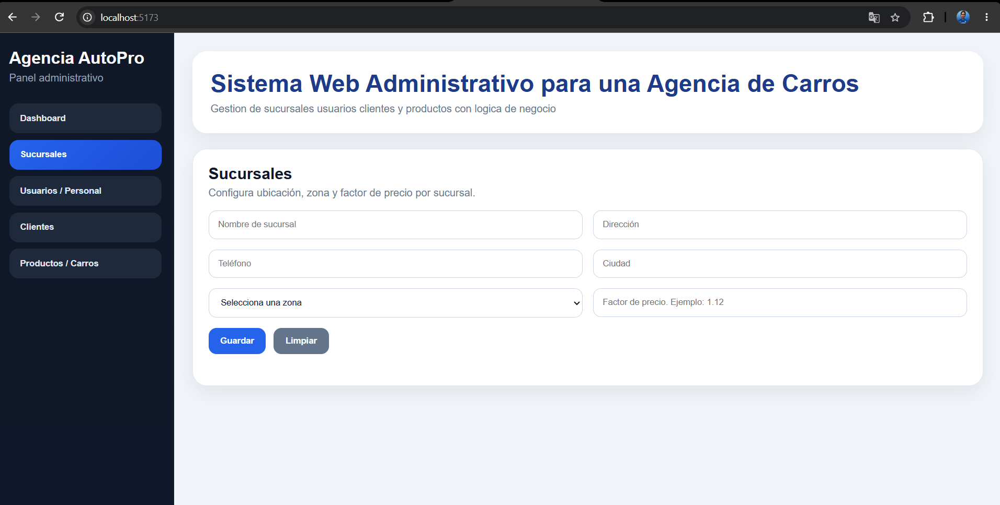
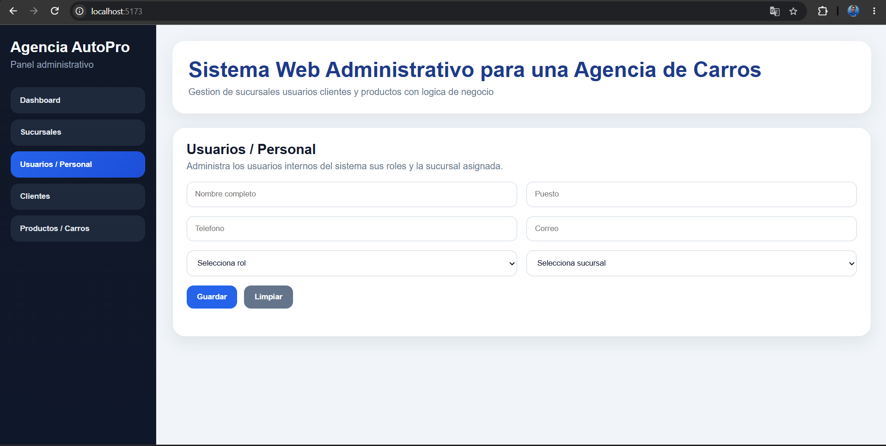
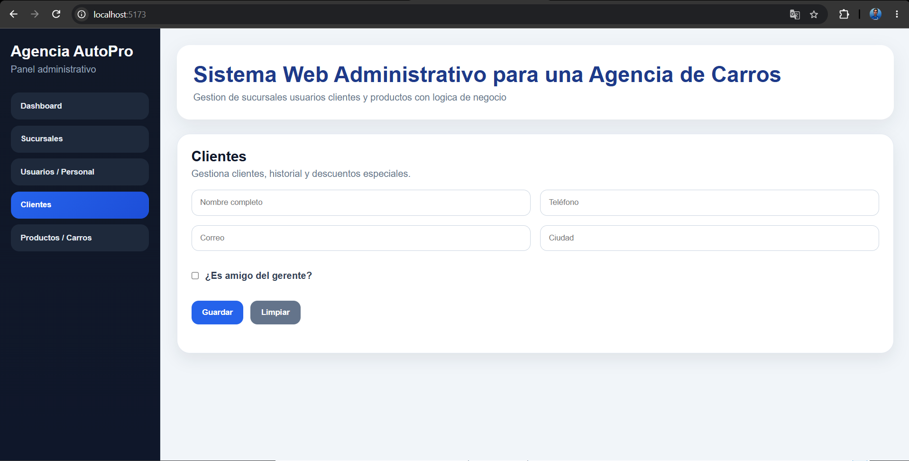
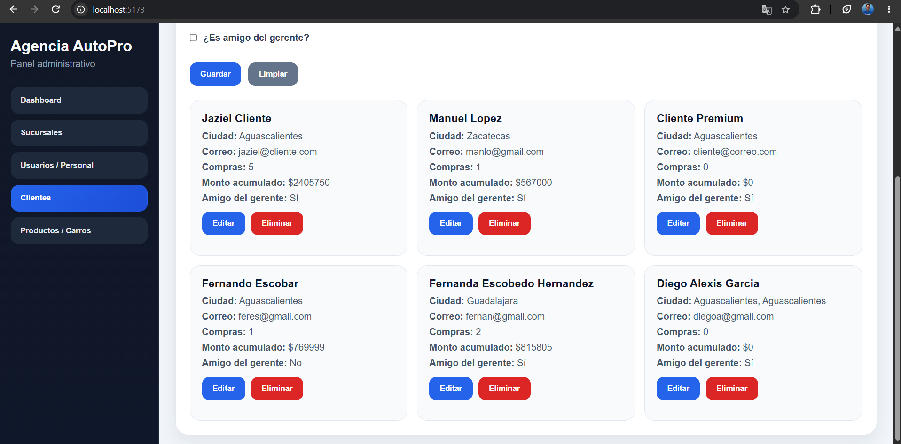
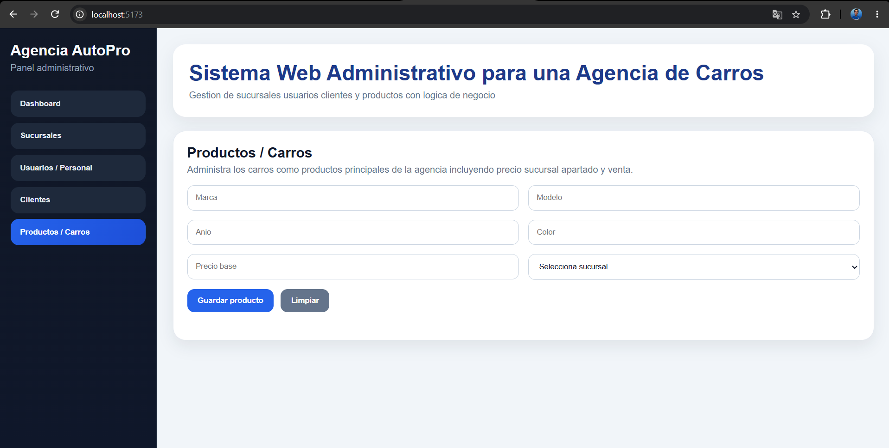
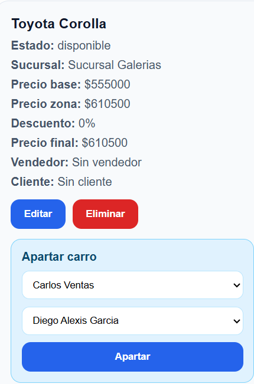
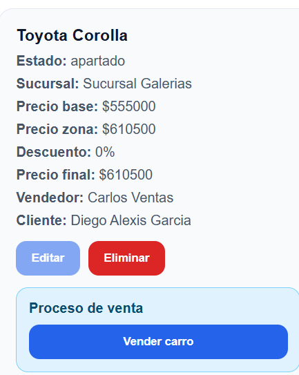
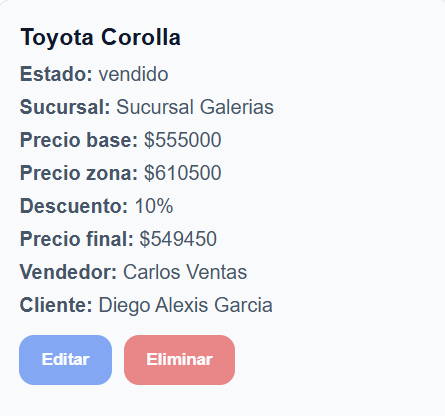

# Agencia AutoPro

Sistema web full stack para la administración de una agencia automotriz.

La aplicación permite gestionar sucursales, personal, clientes y vehículos, además de implementar reglas de negocio relacionadas con precios por zona, descuentos, apartados y venta de automóviles.



---

## Descripción

Agencia AutoPro es un sistema web administrativo desarrollado como proyecto académico de desarrollo web.

El sistema cuenta con un frontend desarrollado con Vue.js y Vite, conectado a un backend construido con Node.js y Express mediante una API REST.

La aplicación permite realizar operaciones CRUD sobre los diferentes módulos de la agencia y administrar el proceso de venta de vehículos.

---

## Funcionalidades

- Dashboard con resumen general del sistema.
- Registro, edición y eliminación de sucursales.
- Administración de zonas y factores de precio por sucursal.
- Registro y administración de usuarios y personal.
- Asignación de roles y sucursales al personal.
- Registro, edición y eliminación de clientes.
- Manejo del historial de compras de los clientes.
- Aplicación de descuentos especiales.
- Registro y administración de vehículos.
- Asignación de vehículos a sucursales.
- Cálculo de precio base y precio por zona.
- Apartado de vehículos.
- Asignación de vendedor y cliente.
- Venta de vehículos.
- Manejo de estados de vehículos:
  - Disponible.
  - Apartado.
  - Vendido.

---

## Tecnologías utilizadas

### Frontend

- Vue.js
- Vite
- JavaScript
- HTML5
- CSS3

### Backend

- Node.js
- Express
- API REST
- JSON para almacenamiento de datos

---

## Estructura del proyecto

```text
agencia-automotriz/
│
├── backend/
│   ├── controllers/
│   ├── routes/
│   ├── db.json
│   ├── package.json
│   ├── package-lock.json
│   └── server.js
│
├── frontend/
│   ├── src/
│   ├── public/
│   ├── package.json
│   ├── package-lock.json
│   └── vite.config.js
│
├── screenshots/
│   ├── dashboard.png
│   ├── sucursales.png
│   ├── usuarios.png
│   ├── clientes.png
│   ├── clientes-listado.png
│   ├── vehiculos.png
│   ├── carro-disponible.png
│   ├── carro-apartado.png
│   └── carro-vendido.png
│
├── .gitignore
└── README.md
```

---

## API REST

El frontend se comunica con el backend mediante diferentes endpoints.

Entre los recursos principales del sistema se encuentran:

```text
/api/sucursales
/api/personal
/api/clientes
/api/carros
```

Durante el desarrollo, Vite utiliza un proxy para enviar las solicitudes realizadas desde el frontend hacia el servidor backend.

```text
Frontend: http://localhost:5173
Backend:  http://localhost:3000
```

---

## Capturas del sistema

### Dashboard

El dashboard muestra un resumen general de la información almacenada en el sistema, incluyendo sucursales, personal, clientes y vehículos.


---

### Gestión de sucursales

Permite registrar y administrar las diferentes sucursales de la agencia.

Cada sucursal puede contener información como ubicación, ciudad, zona y factor de precio.



---

### Gestión de usuarios y personal

Este módulo permite administrar al personal interno de la agencia.

Se pueden registrar datos del empleado, asignar un rol y asociarlo a una sucursal.



---

### Gestión de clientes

Permite registrar y administrar los clientes de la agencia.

También se pueden manejar características especiales utilizadas por las reglas de negocio del sistema.



---

### Operaciones CRUD de clientes

Los clientes registrados se muestran dentro del sistema y pueden ser modificados o eliminados.



---

### Gestión de productos y vehículos

Este módulo permite registrar los automóviles disponibles en la agencia.

Se almacenan datos como:

- Marca.
- Modelo.
- Año.
- Color.
- Precio base.
- Sucursal.



---

## Proceso de apartado y venta

Una de las principales reglas de negocio implementadas es el cambio de estado de los vehículos durante su proceso de comercialización.

El automóvil puede pasar por los siguientes estados:

```text
Disponible
    ↓
Apartado
    ↓
Vendido
```

### Vehículo disponible

Cuando un automóvil está disponible, el sistema permite seleccionar un vendedor y un cliente para realizar el apartado.



---

### Vehículo apartado

Después de realizar el apartado, el vehículo queda asociado al cliente y al vendedor correspondiente.

Desde este estado se puede completar el proceso de venta.



---

### Vehículo vendido

Una vez completada la venta, el sistema actualiza el estado del vehículo a vendido.

También se muestran los datos finales de la operación, incluyendo:

- Precio base.
- Precio por zona.
- Descuento.
- Precio final.
- Vendedor.
- Cliente.



---

### Flujo completo del vehículo

<table>
  <tr>
    <td align="center"><strong>Disponible</strong></td>
    <td align="center"><strong>Apartado</strong></td>
    <td align="center"><strong>Vendido</strong></td>
  </tr>
  <tr>
    <td>
      
    </td>
    <td>
      
    </td>
    <td>
      
    </td>
  </tr>
</table>

---

## Instalación y ejecución

### 1. Clonar el repositorio

```bash
git clone https://github.com/juanelooisga/agencia-automotriz.git
```

Entrar a la carpeta:

```bash
cd agencia-automotriz
```

### 2. Ejecutar el backend

Abrir una terminal y ejecutar:

```bash
cd backend
npm install
node server.js
```

El servidor backend se ejecuta localmente en:

```text
http://localhost:3000
```

### 3. Ejecutar el frontend

Abrir otra terminal y ejecutar:

```bash
cd frontend
npm install
npm run dev
```

Vite mostrará la dirección local de la aplicación.

Normalmente:

```text
http://localhost:5173
```

---

## Objetivo del proyecto

El objetivo de este proyecto fue desarrollar una aplicación web full stack que permitiera aplicar conocimientos relacionados con:

- Desarrollo frontend.
- Desarrollo backend.
- APIs REST.
- Operaciones CRUD.
- Comunicación cliente-servidor.
- Manejo de datos.
- Reglas de negocio.
- Organización modular de una aplicación web.

---

## Aprendizajes

Durante el desarrollo del proyecto se trabajaron conceptos como:

- Creación de componentes e interfaces con Vue.
- Desarrollo de servicios backend con Node.js y Express.
- Creación y consumo de endpoints REST.
- Uso de métodos HTTP.
- Manejo de formularios.
- Validación de información.
- Administración de estados de vehículos.
- Implementación de reglas de negocio.
- Comunicación entre frontend y backend.

---

## Demo

Actualmente el proyecto puede ejecutarse de manera local.

Próximamente se agregará una versión desplegada en internet para permitir probar la aplicación directamente desde el navegador.

---

## Autor

Juan Isais Garcia

GitHub: [@juanelooisga](https://github.com/juanelooisga)

---

## Nota

Los nombres, correos, clientes, vendedores, vehículos y demás información mostrada dentro del sistema se utilizan únicamente como datos de prueba para demostrar el funcionamiento de la aplicación.

---

Proyecto desarrollado con fines académicos y de portafolio.